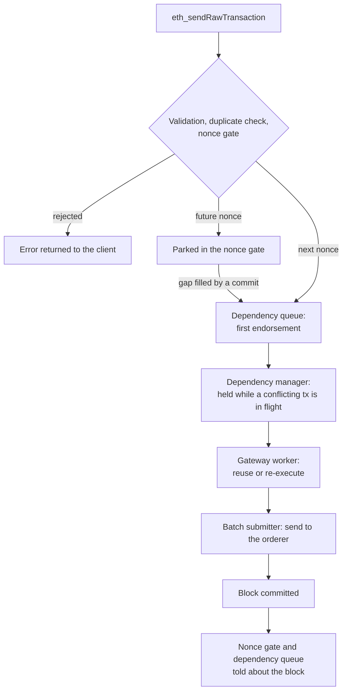

# Transaction failures

This page describes what happens to a transaction after `eth_sendRawTransaction`: the stages it passes through in the gateway, where it can fail, and who learns about each failure. It also sets out the rules for handling errors in this part of the code. It describes the code as it is today; the gaps that are still open are listed at the end.

## The path of a transaction

The client gets the transaction hash back as soon as the transaction is admitted. Everything after that runs in the background, and the only way the client learns the outcome is by polling for a receipt or calling `eth_getTransactionByHash`.

1. **Admission.** `Gateway.SendTransaction` validates the transaction, rejects one that is already pending, and hands it to the nonce gate. The nonce gate queues the sender's next nonce, parks a higher one until the gap fills, and rejects a lower one. A rejection is returned to the client; an admitted transaction gets its hash back.
2. **First endorsement.** The dependency queue (`DepGraphQueue`) endorses the transaction on its endorse workers to learn its read-write set, then passes it to the dependency manager in batches.
3. **Scheduling.** The dependency manager holds the transaction while another transaction that touches the same keys is in flight, and releases it once nothing it depends on is left.
4. **Final endorsement.** A gateway worker takes the released transaction. If, as far as the gateway knows, nothing the first endorsement read has changed since, and it is less than 64 blocks old, that endorsement is reused; otherwise the transaction is executed again.
5. **Submission.** The batch submitter sends the endorsed transaction to the orderer.
6. **Commit.** When the block arrives, the gateway stores it, the nonce gate advances the sender's nonce and releases any parked transaction that is now ready, and the dependency queue hands every transaction in the block back to the dependency manager, valid or not, which frees whatever was waiting on them.

The nonce gate and the dependency manager hold transactions for different reasons. The nonce gate orders one sender's transactions by nonce. The dependency manager orders transactions from different senders that touch the same keys. A transaction can be held by both on its way through.

## Error-handling rules

Errors fall into three groups. New and reworked code handles each group the same way; the places that do not follow these rules yet are marked in the table below and listed under [Open gaps](#open-gaps).

1. **An error that should never happen.** For example, the queue is full or an endorsement carries no read-write set. Log it at ERROR, call `common.DebugPanic`, then return the error. `DebugPanic` panics in every normal build, so these cases are loud in development and CI; a build made with `-tags release` turns it into a no-op so the gateway keeps running.
2. **An expected error that a retry can fix.** For example, a network failure towards a remote endorser. The component that made the call retries it itself and reports the error only once retrying is hopeless. The gateway, the dependency queue and the nonce gate never retry a transaction. No component has such a retry loop yet.
3. **Anything else.** The transaction is dropped and the failure is logged.

At admission, errors are returned to the client, with the codes listed in [JSON-RPC errors](JSON_RPC_ERRORS.md). After admission there is no caller left to answer, so the outcome is one of: committed, dropped, or still waiting.

## What a dropped transaction looks like to a client

A dropped transaction is never committed, so it has no receipt. While the gateway tracks it, `eth_getTransactionByHash` returns it as pending; once it is dropped, the same call returns `null`. Its nonce has not been used, so the client can send the same transaction again. Clients see the same thing when a geth node evicts a transaction from its pool: ethers v6, for example, keeps waiting for a receipt until the application's own timeout.

If a later transaction from the same sender is parked behind the dropped one, it waits for the missing nonce. If that nonce never arrives, the parked transaction is removed after three minutes (the nonce gate checks every 30 seconds).

## Where a transaction can fail

| Stage | Failure | What happens | Client | Dependency manager | Sender's nonce |
|---|---|---|---|---|---|
| Admission | Invalid transaction: not replay-protected, rejected by geth's transaction checks (type, size, gas, fees), or a bad signature | Rejected | Error `-32003` | Never sees it | Unchanged |
| Admission | Same transaction already pending | Rejected | Error `-32003` | Never sees it | Unchanged |
| Admission | Nonce too low, or too many parked for the sender | Rejected | Error `-32003` | Never sees it | Unchanged |
| Admission | Sender's nonce cannot be read | Rejected | Error `-32003` today (meant to be `-32603`, see [Open gaps](#open-gaps)) | Never sees it | Unchanged |
| Admission | Dependency queue full | Error log and `DebugPanic`, then rejected | Error `-32003` (release build) | Never sees it | Unchanged |
| Admission | Dependency queue closed (shutdown) | Rejected | Error `-32003` | Never sees it | Unchanged |
| Nonce gate | Parked transaction's gap never filled | Removed after three minutes | Dropped | Never sees it | Unchanged |
| Nonce gate | Released transaction refused by the queue | Dropped, with an error log and `DebugPanic` unless the queue is closed; a duplicate is ignored, since the queue already holds it | Dropped | Never sees it | Unchanged |
| First endorsement | Endorsement fails | Dropped | Dropped | Never sees it | Unchanged |
| First endorsement | Endorsement has no readable read-write set | Panic ([#386](https://github.com/hyperledger/fabric-x-evm/issues/386)) | - | Never sees it | - |
| Scheduling | Dependency manager returns a reference the queue never issued | Panic ([#386](https://github.com/hyperledger/fabric-x-evm/issues/386)) | - | - | - |
| Scheduling | Released transaction is no longer tracked | Skipped with a warning; its node is not handed back ([#423](https://github.com/hyperledger/fabric-x-evm/issues/423)) | - | Anything waiting on it stays held | - |
| Final endorsement | Re-execution fails | Logged, handed back | Dropped | Handed back | Unchanged |
| Submission | Submission fails, including endorsements that disagree | Logged, handed back | Dropped | Handed back | Unchanged |
| After submission | Transaction never appears in a block | Nothing | Stays pending, no receipt | **Never handed back** ([#423](https://github.com/hyperledger/fabric-x-evm/issues/423)) | Unchanged |
| Commit | Fabric rejects it (for example an MVCC conflict) | Stored with receipt `status = 0`, handed back | Receipt with `status = 0` | Handed back | Unchanged |
| Commit | Committed transaction cannot be parsed | Panic ([#171](https://github.com/hyperledger/fabric-x-evm/issues/171)) | - | - | - |

`DebugPanic` stops the process in every build except one made with `-tags release`, so in development and CI the rows that use it end in a panic rather than a drop or a rejection.

"Handed back" means the dependency queue returns the transaction's node to the dependency manager, which is what releases the transactions that depend on it. A transaction that fails before it reaches the dependency manager has no node, so nothing can be waiting on it.

An EVM revert is not a failure in this sense: the transaction is endorsed and committed, and its receipt has `status = 0` with the sender's nonce used, as on Ethereum.

## Open gaps

- **A transaction that never appears in a block is never handed back.** Once the orderer has accepted a submission, nothing notices if the transaction is lost, so the transactions that depend on it stay held forever and the manager's waiting slots slowly fill. This needs a time limit, without risking a second submission of a transaction that did land ([#423](https://github.com/hyperledger/fabric-x-evm/issues/423)).
- **Re-execution does not update the dependency manager.** When the final endorsement re-executes a transaction, the manager still holds the read-write set from the first execution, so a key that only the re-execution touches is not protected ([#423](https://github.com/hyperledger/fabric-x-evm/issues/423)).
- **Only the dependency queue hears about a failed submission.** Other consumers, such as the perf harness, are not told and keep waiting ([#426](https://github.com/hyperledger/fabric-x-evm/issues/426)).
- **A Fabric rejection looks like a revert.** Its receipt has `status = 0`, which on Ethereum means the transaction ran and used its nonce; here the nonce is still free. Retrying and recording such transactions belong to [#50](https://github.com/hyperledger/fabric-x-evm/issues/50) and [#51](https://github.com/hyperledger/fabric-x-evm/issues/51).
- **An execution failure is not yet committed as failed.** A valid transaction whose execution fails without reverting (out of gas, an invalid opcode) is endorsed, but the client can still see it disappear instead of getting a failed receipt ([#312](https://github.com/hyperledger/fabric-x-evm/issues/312)).
- **A failure to read the sender's nonce is reported as a rejection.** The nonce gate returns it without wrapping `domain.ErrNonceLookup`, so the API answers `-32003` instead of the `-32603` that [JSON-RPC errors](JSON_RPC_ERRORS.md) specifies.
- **The remaining panics** in the dependency queue and in block parsing are being replaced by the rules above ([#386](https://github.com/hyperledger/fabric-x-evm/issues/386), [#171](https://github.com/hyperledger/fabric-x-evm/issues/171)).
- **A lagging endorser makes the submission fail.** If one endorser has not applied a block yet, the endorsements disagree and the submission is dropped. Keeping the gateway and its endorsers in step is [#421](https://github.com/hyperledger/fabric-x-evm/issues/421).

The overall plan for the dependency manager is in [#371](https://github.com/hyperledger/fabric-x-evm/issues/371).
