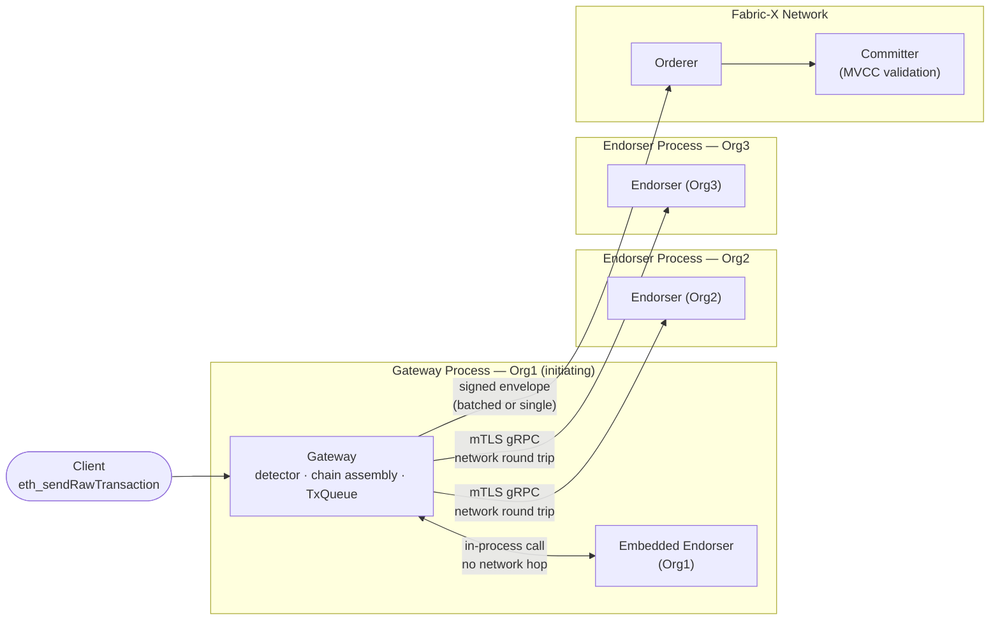
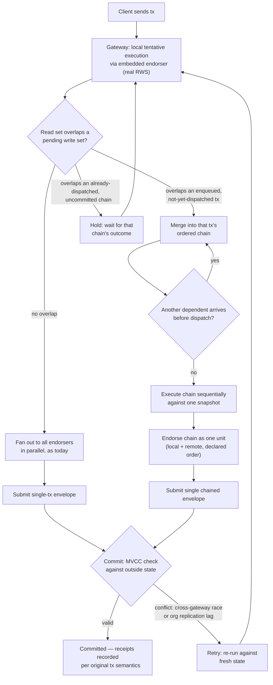

# Dependency-Aware Transaction Scheduling — Design Overview

> Part 0 of a design for closing the gap between Fabric-X's execute-order-commit
> model and the sequential-execution behavior clients expect from an
> Ethereum-compatible chain.

## Summary

- **The gap:** Fabric-X endorses each transaction independently, per org,
  against that org's current ledger height — ordering across separately
  submitted transactions isn't fixed until commit. A client that submits
  dependent transactions back-to-back without waiting for confirmation
  (`approve` → `transferFrom`, swap → supply, faucet → spend) can have the
  later one execute against stale state. On a sequential-execution chain this
  just works; here it silently diverges or gets rejected as an MVCC conflict,
  depending on validator strictness.
- **Not a test artifact:** this hits any impatient client — bots, relayers,
  wallets pipelining nonces — not just test frameworks. It's cheaply
  reproducible today via OpenZeppelin's Hardhat suite (`GovernorHelper.delegate()`'s
  `Promise.all()`, ~30 flaky tests), which is where it was found, not the
  extent of the problem.
- **Why the obvious fix fails:** a dependency-aware queue that blocks
  transactions sharing an address fixes the race but collapses throughput on
  small/hot-account workloads — exactly the shape of realistic DeFi traffic —
  because "touches the same contract" isn't the same as "touches the same
  storage slot."
- **Proposed direction:** reuse the real, slot-level read/write set the
  endorser already computes for every transaction to detect actual
  dependencies between concurrently in-flight transactions, then chain
  detected dependents into one deterministically-ordered endorsement/commit
  unit instead of racing them or fully serializing on commit confirmation.
  Retry, rather than reject, the residual conflicts that are genuinely
  unpredictable (cross-gateway races, org replication lag) — those are
  inherent to concurrent submission and not this bug.
- **V1 scope:** the initiating org's own gateway acting alone (every gateway
  will embed its own endorser). Multi-gateway coordination and any future
  orderer-native batching support are staged as explicit follow-ups, not
  blockers.

## Goals

- **No throughput collapse on realistic workloads.** A small, heavily-shared
  pool of hot accounts/contracts (concentrated DeFi activity, not just
  synthetic test suites) must not degrade toward full serialization.
  Conflict detection has to be precise enough to tell "touches the same
  contract" apart from "touches the same storage slot."
- **Cross-account, not just same-sender.** The race is triggered by
  dependencies between different accounts (`approve` → `transferFrom`,
  faucet → spend), so ordering by sender nonce alone doesn't cover it.
- **Sound for real Ethereum-like traffic, not a test-suite patch.** The fix
  has to hold for bots, relayers, and wallets pipelining transactions — the
  OZ Hardhat suite is where the bug is cheaply reproducible, not the shape
  of what's being fixed.
- **Fits execute-order-commit as it exists today.** No assumption of a
  single global sequencer or a different consensus/execution model; the
  design has to work with each org endorsing independently against its own
  ledger height.
- **V1 is self-sufficient for a single gateway.** Relies only on the
  initiating org's own embedded endorser (soon guaranteed on every gateway)
  — not on other orgs adopting anything, and not on a shared mempool across
  gateways.
- **Reuse existing machinery.** The endorser already computes a real,
  slot-level read/write set for every transaction (`blocks.ReadWriteSet`,
  per-key `Version`) — the same data commit-time MVCC already relies on.
  Detection should be built on that, not a new, coarser heuristic.
- **Don't hard-depend on unshipped infrastructure.** Must not require the
  orderer's hinted future batching/sequencing feature to be correct — free
  to use it to simplify or strengthen the design later, not a precondition
  now.

## Non-Goals

- **Eliminating MVCC.** Commit-time validation stays. It's the correct
  backstop for genuinely unpredictable conflicts — a different gateway's
  in-flight work, org replication lag — this design only removes the
  self-caused, knowable-in-advance class.
- **Solving multi-gateway coordination in V1.** Only the retry primitive for
  the residual cross-gateway race is in scope. A fuller coordination
  mechanism (e.g. a min-block-hint so a lagging org's endorser doesn't
  needlessly diverge) is deferred until retry-only data shows it's needed.
- **Depending on orderer-native batching.** The design must stand on its own
  without the orderer's hinted future sequencing/batching feature. If it
  ships, it's an optimization (and a cleaner long-term substitute for the
  single-envelope mechanism below) — not a precondition.
- **Changing the client-facing API.** No new "submit as a bundle" endpoint
  or client-declared dependency signal for V1. Dependencies are inferred
  entirely server-side from the real read/write set; a client-declared
  alternative was considered and set aside because it doesn't fix traffic
  that gives no such signal (e.g. `Promise.all()`-style concurrent
  submission).
- **Changing endorsement policy semantics.** Which orgs must endorse, and
  how many, is untouched.
- **Same-sender/same-signer-only sequencing (#61).** Related and
  complementary, but narrower than — and not a substitute for — the
  cross-account detection this design does.

## Alternatives Considered

- **Nonce parking (#52 — same-sender ordering only).** Doesn't help: the
  race is cross-account (`approve` from one signer, `transferFrom` by
  another; a faucet payout and the recipient's spend), so ordering a single
  sender's own nonces doesn't touch it.
- **Queue-drain fence on `evm_snapshot`/`evm_revert`.** A different
  mechanism solving a different problem — draining the live tx queue around
  snapshot/revert boundaries. Orthogonal to this race, doesn't address it.
- **Dependency-aware queue at address granularity (TxQueueV2).** Built and
  empirically tested — both a full-suite A/B and an isolated diagnostic
  unit test. Correctly fixes the narrow race: transactions sharing a
  participant address are held until the blocking one completes. But it
  collapses to near-total serialization on a small, heavily-shared pool of
  accounts — exactly OZ's pattern, and arguably realistic for concentrated
  DeFi activity too. Root cause: `participantsForTx` in
  [`gateway/core/txqueue_v2.go`](../../../gateway/core/txqueue_v2.go) tracks
  sender/recipient *addresses*, not actual storage-slot overlap, so two
  transactions sharing a hot contract address but touching disjoint slots
  (e.g. two ERC-20 transfers between different holder pairs) are serialized
  needlessly. This is the direct motivation for detecting dependencies via
  the real read/write set instead — see [Goals](#goals) and
  [Planned Transaction Flow](#planned-transaction-flow).

## System Topology

- **The embedded endorser is the only "free" execution.** It's an in-process
  call, no network hop — the reason local, real-RWS-based dependency
  detection can run on every transaction before anything crosses an org
  boundary. Config-wise this is the `endorser` (singular) vs.
  `gateway.endorsers` (plural, remote) split in
  [`gateway/config/config.go`](../../../gateway/config/config.go).
- **Org2 and Org3 are separate processes**, each reached over mTLS gRPC,
  each endorsing independently against its own ledger height. That boundary
  is exactly why cross-gateway staleness (a different org's in-flight work,
  replication lag) is a genuinely unpredictable conflict rather than
  something the initiating gateway could ever detect in advance — see
  [Non-Goals](#non-goals).
- **The Fabric-X network is shared, external infrastructure.** The envelope
  this design produces — chained or not — is validated there by ordinary
  commit-time MVCC, same as today. Nothing in this design changes that
  layer.
- **The topology itself is unchanged** between today and the planned design;
  only the gateway's own logic before dispatch changes. This diagram applies
  to both.

## Planned Transaction Flow

- **Detection** happens once, locally, before any network round trip: the
  embedded endorser's real read/write set (not an address heuristic) decides
  whether a transaction is independent or a dependent of something already
  in flight.
- **Three outcomes** from that check: proceed alone (no overlap), join an
  existing not-yet-dispatched chain (mergeable), or hold behind an
  already-dispatched chain (not mergeable — it's already out the door, so the
  new tx waits for that chain to resolve, then re-enters detection).
- **A chain closes** when no further dependent shows up before dispatch, at
  which point it's executed sequentially against one snapshot and endorsed as
  a single unit — one signed read/write set, one envelope, covering every
  step in the chain in the order the client actually intended.
- **Commit-time MVCC still runs** for every envelope, chained or not — it's
  the correct backstop for genuinely unpredictable conflicts (a different
  gateway's in-flight work, org replication lag), not something this design
  removes. Those failures retry rather than surface to the client, since a
  sequential-execution chain would never have hit them at all.

## Open Questions / Known Complexity

### Known complexity (reasoned through, not yet simple)

- **Pending-tracking spans dispatch *and* commit, not just dispatch.** A
  newly arriving tx has to be checked against both not-yet-dispatched chains
  (mergeable) and already-dispatched-but-uncommitted ones (not mergeable,
  must hold) — see [Planned Transaction Flow](#planned-transaction-flow).
  Two different response paths behind one overlap check, not a single queue.
- **Single-envelope retry is whole-chain, not per-link.** The chain is one
  Fabric-X transaction for V1, so an MVCC conflict on any single link forces
  re-executing and resubmitting the *entire* chain, even if only the last
  link actually collided. This is the concrete cost that native orderer
  batching would remove (independent per-tx failure) — see
  [Non-Goals](#non-goals).
- **The submission backend needs to be swappable.** Single-envelope now,
  orderer-batching later means the "confirmed chain → submit" step should
  sit behind one seam (e.g. `submit(chain []*Tx) error`) that detection and
  retry logic don't need to know the shape of, so the eventual switch
  doesn't require touching the detector.

### Open questions (undecided, need data or a follow-up call)

- **Chain length bound.** Longer chains are expected, not an edge case — a
  hot contract could in principle keep extending one indefinitely. What
  caps chain length or envelope size, and what happens to a tx that would
  extend a chain past that cap? Presumably it falls back to holding for full
  commit confirmation, but the cutoff itself isn't defined.
- **Chain-formation cutoff.** Does a chain close and dispatch as soon as the
  queue has no currently-known mergeable candidate (purely reactive, no
  added latency), or after a short window to catch near-simultaneous
  arrivals? Reactive costs nothing on the independent-tx path but may
  dispatch a link early if a dependent is milliseconds behind; a window adds
  latency to every chain to shave that tail. Leaning reactive-only,
  consistent with starting cheap and adding complexity only if data
  justifies it — not decided.
- **Min-block-hint vs. retry-only for org replication lag.** Deferred
  pending data (see [Non-Goals](#non-goals)) — start retry-only, add the
  hint only if lag-induced retries turn out to be a meaningful share of the
  total.
- **Retry policy.** Bound on attempts, backoff, and what distinguishes
  "genuinely unpredictable, keep retrying" from "something else is wrong,
  stop and surface to the client" isn't defined yet. Feeds directly into
  #51.
- **RAW-only detection may not be sufficient.** Detection as designed checks
  whether a new tx's *read* set overlaps a pending *write* set (RAW) — the
  mechanism that produces an observable MVCC rejection today. Two
  chain-eligible transactions that both *write* the same slot with no shared
  read between them (WAW) may not be caught by that check at all, and
  depending on how the committer actually validates writes, an undetected
  WAW dependency could be worse than a rejection — it could silently commit
  in the wrong order with no error raised. Needs verifying against the
  committer's actual write-validation semantics before assuming RAW coverage
  is sufficient.

## Related Issues

- **Epic:** #4 ([EPIC] Concurrency)
- #59 Implement Dependency-Based Scheduling — this design's primary target
- #52 Support Out-of-Order Transaction Submission — same-sender nonce
  ordering; doesn't cover the cross-account case this design addresses
- #61 Optimize Same-Client Transaction Sequencing — narrower same-signer
  pipelining, complementary rather than overlapping
- #51 Design Failed Transaction Recording — how MVCC conflicts vs. EVM
  reverts surface and retry; this design's retry behavior feeds that decision
- #50 Implement Transaction Mempool with Retry — the retry primitive the
  cross-gateway case in this design needs
